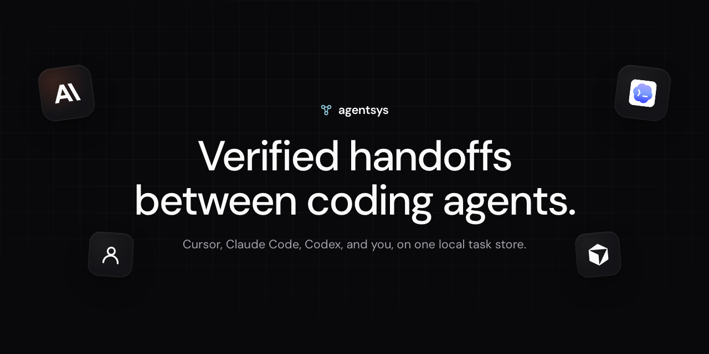
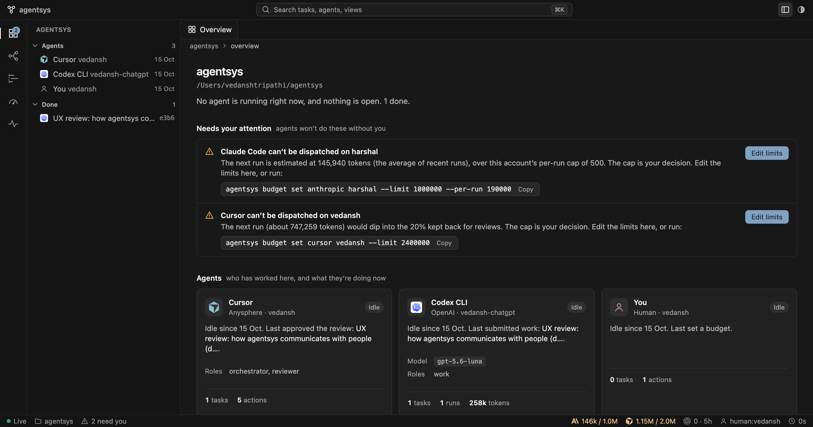

# agentsys

[](LICENSE)
[](pyproject.toml)

**Verified handoff and independent review across AI coding tools, local-first.**

[Site](https://thedeviser.github.io/agentsys/) · [Changelog](https://thedeviser.github.io/agentsys/changelog.html) · [Docs](https://thedeviser.github.io/agentsys/docs/index.html) · [Roadmap](https://thedeviser.github.io/agentsys/docs/roadmap.html)



agentsys is a zero-dependency coordination layer (Python 3.9+, SQLite, git) so Cursor, Claude Code, Codex, Grok Build, OpenCode, and humans share one task store. Work is not done until an automated gate passes and a *different* identity reviews it; merges need a human. Hash-chained audit events, git hooks, MCP worker tools, and per-account budgets are first-class—not afterthoughts.

- **Zero dependencies.** Python ≥ 3.9 standard library, SQLite, and git.
- **Survives crashes.** Claims are time-limited leases. If an agent dies, its task returns to the queue, and the next agent gets a brief that includes the partial work left behind.
- **Isolated.** Each implementation task runs in its own git worktree and branch. Overlapping file scopes can't be worked on concurrently, and merges are dry-run first.
- **Honest about usage.** Token usage is tracked per provider *and* per account, exactly as each CLI reports it. Accounts are never pooled. Runs with no reported usage count at their estimate, never as zero.
- **Human in control.** Merging requires an approval granted by a `human:` actor.

## Install

```sh
git clone https://github.com/theDeviser/agentsys.git ~/agentsys
export PATH="$HOME/agentsys/bin:$PATH"     # or: pip install -e ~/agentsys
agentsys --version
AGENTSYS_DEMO=1 agentsys demo --force      # <30s scripted story
```

**MCP (Cursor):** add a stdio server — `agentsys mcp --as cursor:you:work` — or use the [site install button](https://thedeviser.github.io/agentsys/) after Pages is live.

## Quick start

Run inside any git repository. The store lives at `<repo>/.agent-system/state.db`; add `.agent-system/` to `.gitignore`.

```sh
export AGENTSYS_ACTOR=human:alice
agentsys init
agentsys task add "Locate the settings page" --kind research
agentsys task add "Add a dark-mode toggle" --path "src/settings/*" --check "npm test" --goal "..."

# Agent A (e.g. in Cursor) researches and hands off a finding
agentsys --as cursor:alice:researcher claim t-1234abcd
agentsys --as cursor:alice:researcher finding t-1234abcd "Settings live in src/settings/page.jsx" \
         --evidence src/settings/page.jsx:12
agentsys --as cursor:alice:researcher submit t-1234abcd "located"

# Agent B (e.g. Codex) implements in an isolated worktree, starting from A's findings
agentsys --as codex:alice:implementer claim t-5678efgh     # prints the worktree path
agentsys resume t-5678efgh                                  # self-contained brief: goal, scope, findings, checkpoint
# ...edit files in the worktree...
agentsys --as codex:alice:implementer submit t-5678efgh "toggle added"

agentsys --as system:verifier verify t-5678efgh             # scope, syntax, secret scan, --check commands
agentsys --as claude:bob:reviewer review t-5678efgh approve --reason "diff matches goal"
agentsys --as human:alice merge t-5678efgh                  # requests approval the first time
agentsys --as human:alice approve 1 && agentsys --as human:alice merge t-5678efgh --cleanup
```

### Headless dispatch (optional, spends real quota)

```sh
agentsys adapters                                   # what's installed (also finds CLIs bundled in IDE extensions)
agentsys budget set anthropic bob --limit 1000000   # required before any real dispatch
agentsys dispatch t-5678efgh --adapter claude --account bob --max-usd 2
agentsys dispatch t-5678efgh --adapter grok --account bob          # Grok Build CLI (xAI)
agentsys dispatch t-5678efgh --adapter opencode --account bob      # OpenCode CLI (underlying provider)
agentsys dispatch t-5678efgh --adapter mock         # deterministic, free, labelled [MOCK]
agentsys budget show
```

Budgets are per provider account and never pooled. An account's usage is counted across every project on the
machine (`~/.agentsys/ledger.db`, override with `AGENTSYS_LEDGER`), so a cap holds whichever repo dispatches.

```sh
agentsys budget set anthropic bob --limit 1000000 --per-run 200000   # total cap + refuse any single run above 200k
agentsys budget set openai me --limit 0 --window-hours 5             # no cap; track usage over a rolling 5h window
```

Caps are checked before a run starts. CLIs can't be stopped mid-run on tokens, so a run that goes over is
reported afterwards rather than prevented.

### Dashboard

```sh
agentsys ui --also ~/other-project      # http://127.0.0.1:8791 (add --read-only to disable edits)
```

It shows what each agent is doing now, how every task moved between agents, a run timeline with tokens, spend
per account, and anything waiting on you, with the exact command to run next. Deep links: `?view=flow|runs|budget|activity`,
`?task=<id>`, `?theme=light|dark`. Provider logos are from [LobeHub Icons](https://github.com/lobehub/lobe-icons) (MIT).

## Task states

```
ready → in_progress → submitted → verified → accepted → merged
          │   ▲            │          │
          │   └ lease expiry (attempts < max) ┘ → escalated (human requeues)
          ▼                ▼          ▼
       blocked     changes_requested ←┘ (verify fail / review reject) → claim again
```

| Rule | Enforced by |
|---|---|
| Only the owner can submit or release | `store.transition(owner_only=True)` |
| Dependencies must be accepted/merged before claim | `Store.claim` |
| Overlapping `--path` scopes can't both be in progress | `Store.claim` |
| Anyone who claimed or checkpointed a task can't review it | `cmd_review` |
| Only `human:` actors can grant approvals | `Store.decide_approval` |
| Every state change writes an audit event in the same transaction | `Store._move` |

## Verification pipeline

| Check | What it does |
|---|---|
| scope | every changed file matches the task's `--path` globs |
| syntax | `bun build --no-bundle` for JS/JSX/TS (if bun is installed), `py_compile`, JSON parse |
| secrets | regex scan of *added* lines and forbidden filenames (`.env`, `*.pem`, …). Matches are reported by type, never echoed. |
| commands | each `--check` command, run in the worktree |
| evidence | research tasks need at least one finding with `--evidence` |

## Adapters

| Adapter | CLI | Usage data | Sandbox defaults |
|---|---|---|---|
| `mock` | built in | zero, labelled `mock` | n/a |
| `cursor` | `cursor-agent -p --output-format json` | provider-reported `usage` | `--sandbox enabled`; `--mode ask` for research |
| `claude` | `claude -p --output-format json` | provider-reported `usage` + `total_cost_usd` | `--allowedTools` limited to Read/Glob/Grep(/Edit/Write) |
| `codex` | `codex exec --json` | provider-reported `turn.completed.usage` | `--sandbox read-only` / `workspace-write` |
| `grok` | `grok --prompt-file … --output-format json` | provider-reported `usage` + `total_cost_usd` when complete | `--sandbox read-only` / `workspace` |
| `opencode` | `opencode run --format json` | summed `step_finish` tokens + `part.cost` | `OPENCODE_CONFIG_CONTENT` permissions (read-only / write) |

Adapters strip provider API-key variables from the child environment, so a run never silently switches from a subscription login to pay-per-token API billing.

## What agentsys is not

- **Not a security boundary.** Actor identities are self-declared, and the store is a local file. It prevents agent *mistakes*, not malicious local processes. See [SECURITY.md](SECURITY.md).
- **Not a quota pool.** It never combines, transfers or rotates accounts to get around provider limits.
- **Not able to see interactive IDE usage.** Usage in chat panels is invisible unless self-reported with `agentsys usage add`.

## Development

```sh
python3 -m unittest discover -s tests -v
agentsys verify-log
agentsys doctor
agentsys mcp    # stdio worker MCP; see docs/integrations.md
```

## License

MIT. See [LICENSE](LICENSE).

## Trademarks

Cursor, Claude, Codex, Grok, OpenCode, and other product names and logos are trademarks of their respective owners. They are used only to identify compatible tools; agentsys is an independent project. See [THIRD_PARTY_NOTICES](site/THIRD_PARTY_NOTICES.md).
